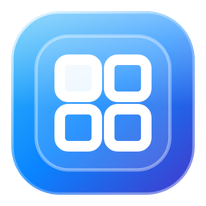
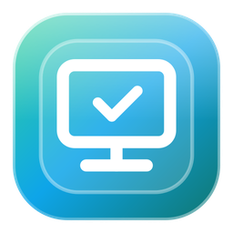
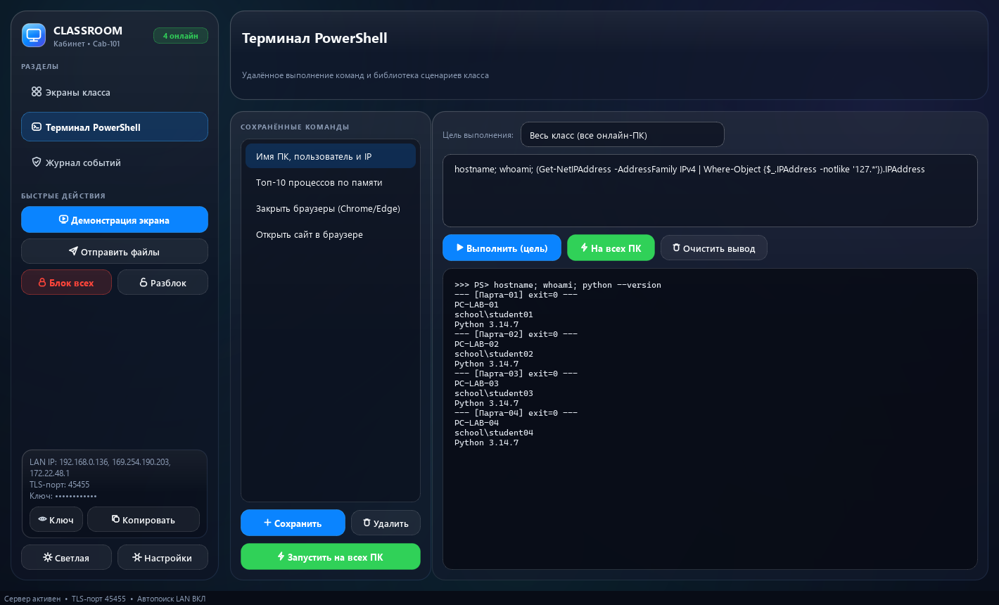
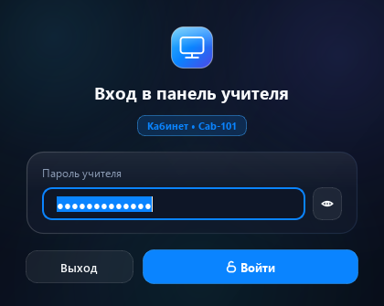
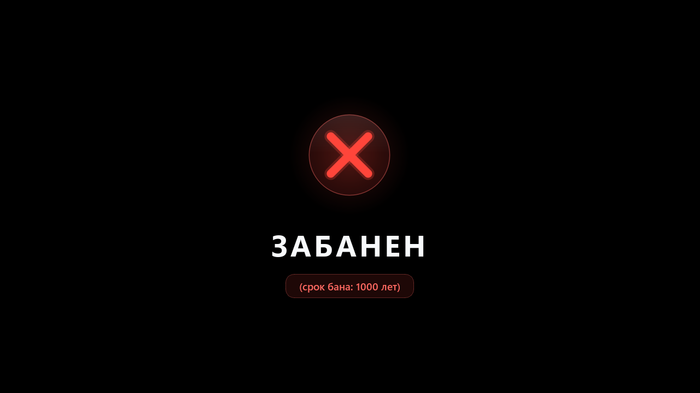

# Classroom Manager 2.0

**Современная система управления компьютерным классом для Windows LAN в дизайне Liquid Glass — без статических IP, сложных служб и визуального шума.**

[-0A84FF?logo=github)](https://github.com/kir1lka/classroom-manager/releases/latest)


[](LICENSE)

<br clear="left" />

**Classroom Manager 2.0 (Liquid Glass Edition)** — это быстрый, защищённый и полностью автономный комплекс из двух портативных Windows-приложений (**Консоль учителя** и **Агент ученика**) для школьных кабинетов информатики, университетских лабораторий и учебных центров. Живой мониторинг экранов, чёткое HD-управление 1:1, демонстрация экрана учителя, Drag & Drop раздача файлов, блокировка ПК и массовый запуск PowerShell работают сразу из коробки в обычной DHCP-сети.

---

## Быстрое скачивание готовых `.exe` (без установки Python)

Готовые переносимые сборки не требуют установки Python, СУБД или дополнительных библиотек — просто скачайте файлы со страницы **[Последнего релиза (Releases)](https://github.com/kir1lka/classroom-manager/releases/latest)**:

| Приложение / Скрипт | Назначение | Куда устанавливать |
| :--- | :--- | :--- |
|  **[`ClassroomTeacher.exe`](https://github.com/kir1lka/classroom-manager/releases/latest)** | Десктопная консоль управления классом (интерфейс **Liquid Glass**) | Компьютер **преподавателя** |
|  **[`ClassroomStudent.exe`](https://github.com/kir1lka/classroom-manager/releases/latest)** | Тихий фоновый агент в системном трее с автопоиском учителя в LAN | Компьютеры **учеников / студентов** |
| **`setup_firewall.ps1`** | Однократное открытие LAN-портов в Брандмауэре Windows | ПК преподавателя (от имени Администратора) |

> [!TIP]
> Автоматическая сборка свежих релизов настроена через GitHub Actions (`.github/workflows/build-release.yml`), а для локальной упаковки предусмотрен скрипт `scripts/build_exe.ps1`.

---

## Ключевые плюсы и преимущества

Почему **Classroom Manager 2.0** удобнее классических решений вроде **Veyon** или **Radmin** в реальном школьном или университетском классе:

1. **Работает без статических IP (`Zero-Config Smart Discovery`)**
   В отличие от систем, требующих ручного прописывания статических IP каждому ученическому ПК, здесь ученики сами находят преподавателя через **3-уровневый автопоиск в LAN**: зашифрованный тегом UDP Broadcast-маячок по `ID кабинета` → кэш имени ПК (`hostname` / локальный DNS) и последнего рабочего адреса → опциональный резервный адрес. Динамический DHCP и перезагрузка роутера больше не ломают класс, а соседние кабинеты в одной подсети не пересекаются.
2. **Современный интерфейс iOS / macOS Liquid Glass (`Dark & Light`)**
   Полупрозрачные матовые панели, мягкие акценты, переключение между тёмной и светлой темой в 1 клик без перезапуска, мгновенный живой поиск по партам/ученикам, аккуратная контекстная панель без нагромождения кнопок и кастомные системные иконки Windows.
3. **Чёткая HD-трансляция `1:1` и полноценная мультимониторность**
   Мгновенное переключение между мониторами ученика (`Монитор 1`, `Монитор 2`, `Все мониторы`), гибкие пресеты качества вплоть до **Оригинала 1:1 (HD 4:4:4)** без «мыла» на мелком коде и тексте, а также демонстрация экрана учителя всему классу в 1 клик.
4. **Мгновенная раздача файлов (`Drag & Drop` + `SHA-256`)**
   Перетаскивайте задания, презентации или архивы прямо из Проводника Windows на карточку конкретного ПК или сразу на весь класс. Доступен выбор целевой папки (`Рабочий стол`, `Загрузки`, `Документы`, `Общий рабочий стол` или произвольный путь), контроль целостности по `SHA-256` и опция автоматического открытия файла у учеников.
5. **Встроенная студия PowerShell**
   Собственная библиотека сохранённых скриптов и команд с понятными названиями и массовое асинхронное выполнение на выбранном ПК или всём классе с корректной кодировкой `UTF-8` и детальным отчётом по каждой машине.
6. **Криптографическая защита уровня Enterprise**
   Шифрование трафика **TLS 1.2 / 1.3** с поддержкой привязки сертификата (`SHA-256 pinning`), взаимная проверка ключа класса **HMAC-SHA256 Challenge-Response**, хранение паролей через **`scrypt` + соль**, защита настроек и выхода агента ученика паролем и секретным глобальным хоткеем `Ctrl+Alt+Shift+M`.
7. **Лёгкость и абсолютная портативность**
   Всего два компактных `.exe` файла. Никаких тяжёлых системных служб, драйверов перехвата видео, внешних баз данных, обязательного домена Active Directory или облачных подписок.

### Краткое сравнение с аналогами

| Возможность | Classroom Manager 2.0 | Veyon | Radmin |
| :--- | :---: | :---: | :---: |
| **Работа при динамических IP (DHCP) без ручной карты адресов** | Да (Smart Discovery) | Требует статики / DNS / AD | Требует знания IP каждого ПК |
| **Установка в 2 портативных `.exe` без служб и драйверов** | Да | Нет (инсталлятор + службы) | Нет (инсталлятор + служба) |
| **Современный UI с темами Dark / Light (Liquid Glass)** | Да | Классический Qt UI | Утилитарный Win32 UI |
| **Демонстрация экрана учителя всему классу в 1 клик** | Да | Да | Нет |
| **Drag & Drop раздача файлов всему классу с автооткрытием** | Да (с проверкой SHA-256) | Ограниченно | Только 1-на-1 через проводник |
| **Встроенная библиотека массовых PowerShell-скриптов** | Да (UTF-8) | Только базовый запуск команд | Нет |

---

## Скриншоты интерфейса (Liquid Glass UI)

### Панель учителя — Тёмная тема Liquid Glass


### Панель учителя — Светлая тема Liquid Glass


### Студия PowerShell и библиотека сохранённых команд


### Авторизация учителя и защищённые настройки агента ученика

| Вход в консоль учителя | Защищённые настройки агента ученика (`Ctrl+Alt+Shift+M`) |
| :---: | :---: |
|  |  |

### Полноэкранная блокировка экрана ученика


---

## Что умеет программа (полный обзор возможностей)

###  Консоль учителя (`ClassroomTeacher.exe`)

- **Живая сетка мониторинга класса:** адаптивные карточки всех подключённых парт с превью экрана в реальном времени, именем ПК, активным пользователем Windows, заголовком текущего окна, количеством мониторов и задержкой сети (`ping`). Удобный живой фильтр позволяет мгновенно найти нужный компьютер или ученика.
- **Быстрые действия с карточек и контекстной панели:** управление одним учеником или массовые операции над всем классом без лишних диалогов и перегруженных меню.
- **Удалённое HD-управление ПК (`1:1`):** двойной клик по карточке открывает окно детального просмотра и перехвата мыши/клавиатуры. Поддерживается чёткая цветопередача **HD 4:4:4 (1080p / Оригинал 1:1)**, переключение между экранами ученика (`Монитор 1`, `Монитор 2`, `Все мониторы`) и точное позиционирование курсора в мультимониторных конфигурациях (`MOUSEEVENTF_VIRTUALDESK`).
- **Мгновенная блокировка экрана (оверлей внимания / бана):** одной кнопкой перекрывает экран выбранного ПК или сразу **всего класса** поверх всех окон полноэкранным чёрным оверлеем блокировки, мгновенно возвращая внимание аудитории к преподавателю.
- **Трансляция экрана учителя всему классу:** потоковая демонстрация рабочего стола преподавателя на все ученические мониторы в полноэкранном режиме (опоздавшие и переподключившиеся ПК подхватывают эфир автоматически).
- **Drag & Drop доставка файлов:** перетащите один или несколько файлов прямо в окно программы, выберите папку назначения (`Рабочий стол`, `Загрузки`, `Документы`, `Общий рабочий стол` или свой каталог с автосозданием) и включите автозапуск/автооткрытие раздаточного материала по завершении сверки `SHA-256`.
- **Студия PowerShell с библиотекой скриптов:** сохраняйте часто используемые команды (очистка рабочих папок, настройка окружения, проверка ПО, запуск браузера с нужным URL) в постоянную библиотеку и выполняйте их на одном ПК или сразу на всём классе с полным выводом `stdout` / `stderr` в `UTF-8`.
- **Управление питанием и сессией Windows:** системная блокировка учётной записи (`LockWorkStation`), перезагрузка, выключение и отмена таймера выключения с защитой от случайного нажатия.
- **Сообщения и журнал аудита:** мгновенная отправка текстовых уведомлений на экраны учеников и подробное ротируемое логирование всех подключений, команд и действий питания.

###  Агент ученика (`ClassroomStudent.exe`)

- **Незаметная работа в системном трее:** не занимает место на панели задач Windows, отображая только аккуратную иконку со световой индикацией состояния (зелёный — на связи с учителем, жёлтый — поиск в LAN, красный — ошибка ключа).
- **Надёжная защита паролем и секретным хоткеем:** открыть окно настроек, снять локальную блокировку или выгрузить агент можно только после ввода пароля администратора/преподавателя (через иконку трея или глобальное сочетание клавиш `Ctrl+Alt+Shift+M`).
- **Автономное восстановление связи:** при перезагрузке ПК учителя, смене Wi-Fi/LAN-адреса или пробуждении из сна агент сам находит консоль преподавателя и прозрачно переподключается за считанные секунды.

### Схема взаимодействия в локальной сети

```text
+--------------------------------------+         TLS 1.2/1.3 + HMAC-SHA256         +--------------------------------------+
|         ClassroomTeacher.exe         | <=======================================> |         ClassroomStudent.exe         |
|   (Консоль учителя • Liquid Glass)   |                                           |    (Тихий агент в системном трее)    |
+--------------------------------------+      3-Tier Smart Discovery (UDP LAN)     +--------------------------------------+
| • Вход по паролю учителя (scrypt)    | <---------------------------------------> | • Без окна на панели задач           |
| • Живая сетка экранов + поиск ПК     |                                           | • Индикатор статуса в трее Windows   |
| • HD 1:1 управление + мультимонитор  |                                           | • Хоткей Ctrl+Alt+Shift+M + пароль   |
| • Трансляция экрана учителя классу   |                                           | • Полноэкранный оверлей блокировки   |
| • Drag & Drop файлы (SHA-256)        |                                           | • Исполнитель PowerShell (UTF-8)     |
| • Студия PowerShell + аудит событий  |                                           | • Быстрый захват (mss) + SendInput   |
+--------------------------------------+                                           +--------------------------------------+
```

---

## Безопасность

| Уровень защиты | Реализация в Classroom Manager 2.0 |
| :--- | :--- |
| **Шифрование канала** | Обязательный **TLS 1.2 / 1.3** с автоматической генерацией сертификата `RSA-2048` и поддержкой жёсткой привязки отпечатка сертификата (`SHA-256 certificate pinning`) |
| **Аутентификация в LAN** | Взаимная криптографическая проверка каждой сессии по протоколу **HMAC-SHA256 Challenge-Response** на базе общего ключа класса (`PSK`) — чужие ПК и соседние кабинеты отсекаются; сам ключ никогда не передаётся в открытом виде в UDP-маячках |
| **Хранение паролей** | Пароли преподавателя и локального администратора агента хранятся исключительно в виде стойкого криптохеша **`scrypt`** с индивидуальной случайной солью |
| **Контроль целостности и аудит** | Проверка всех передаваемых файлов по **`SHA-256`** и запись всех подключений, команд PowerShell и операций питания в ротируемый журнал аудита |

> [!IMPORTANT]
> **Рекомендация для учебных кабинетов:** запускайте `ClassroomStudent.exe` от имени административной учётной записи (например, через Планировщик заданий Windows при входе любого пользователя), а ученикам предоставляйте стандартную учётную запись Windows (`Standard User`). В этом случае штатные механизмы прав ОС надёжно защитят процесс агента от завершения через Диспетчер задач — без нестабильных системных хуков и ложных срабатываний антивируса.

---

## Быстрый старт за 2 минуты

### Шаг 1. Компьютер учителя (1 минута)
1. Скачайте и запустите **`ClassroomTeacher.exe`**.
2. В мастере первого запуска задайте **Пароль учителя**, укажите **`ID кабинета`** (например, `Cab-101`) и скопируйте автоматически созданный **`Ключ класса`**.
3. Один раз разрешите входящие подключения в локальной сети через PowerShell от имени Администратора:
   ```powershell
   powershell -ExecutionPolicy Bypass -File setup_firewall.ps1
   ```

### Шаг 2. Компьютеры учеников (1 минута)
1. Запустите **`ClassroomStudent.exe`** на ученических ПК.
2. Введите те же **`ID кабинета`** и **`Ключ класса`**, задайте **Пароль администратора** (для защиты настроек и выхода из агента) и при желании укажите удобное имя машины (например, `Парта-01`).
3. Оставьте включённой опцию **«Автоматически находить учителя в LAN»** и нажмите **«Сохранить и подключиться»**.
4. Готово — агент свернётся в системный трей, а карточка ученика сразу появится в сетке на экране учителя!

---

## Сборка из исходников

Для локальной разработки, запуска автотестов или самостоятельной сборки переносимых `.exe` файлов потребуется **Windows 10/11** и **Python 3.11+**:

```powershell
# 1. Клонирование репозитория и создание виртуального окружения
git clone https://github.com/kir1lka/classroom-manager.git
cd classroom-manager
python -m venv .venv
.\.venv\Scripts\pip install -r requirements.txt

# 2. Запуск консоли учителя и агента ученика из исходного кода
.\.venv\Scripts\python.exe -m teacher_app.main
.\.venv\Scripts\python.exe -m student_app.main

# 3. Запуск набора автотестов (протокол, TLS/HMAC, Smart Discovery, передача файлов, PowerShell)
.\.venv\Scripts\pytest.exe -v

# 4. Сборка готовых ClassroomTeacher.exe и ClassroomStudent.exe в папку dist\
powershell -ExecutionPolicy Bypass -File scripts\build_exe.ps1
```

### Структура репозитория

```text
classroom-manager/
├── assets/                  # Фирменные иконки приложений учителя и ученика (.png / .ico)
├── shared/                  # Сетевой фрейминг, TLS 1.3 + HMAC-SHA256 + scrypt, конфиги и логи
├── teacher_app/             # Сервер класса, UDP-ответчик, интерфейс Liquid Glass (PySide6)
├── student_app/             # Трей-агент, 3-уровневый Smart Discovery, mss-стриминг, SendInput
├── scripts/
│   ├── build_exe.ps1        # Автоматическая упаковка двух .exe через PyInstaller
│   └── setup_firewall.ps1   # Настройка правил Брандмауэра Windows для локальной сети
├── docs/screenshots/        # Скриншоты интерфейса Liquid Glass (Dark & Light)
├── tests/                   # Модульные и интеграционные автотесты
└── .github/workflows/       # CI/CD пайплайн сборки и публикации релизов на GitHub
```

---

## Лицензия

Проект распространяется под открытой лицензией **[MIT](LICENSE)**.
