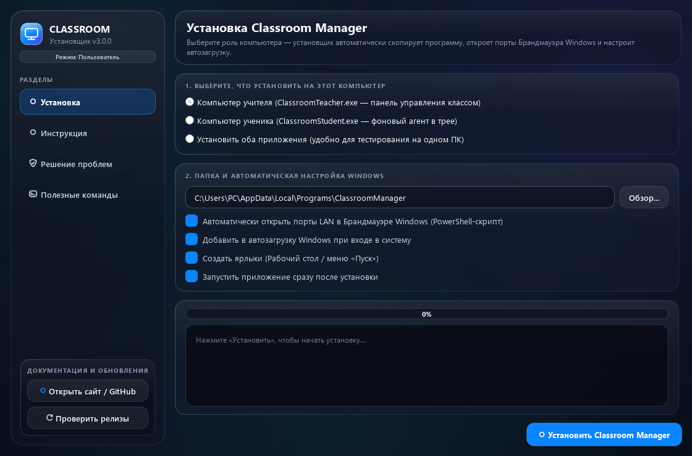
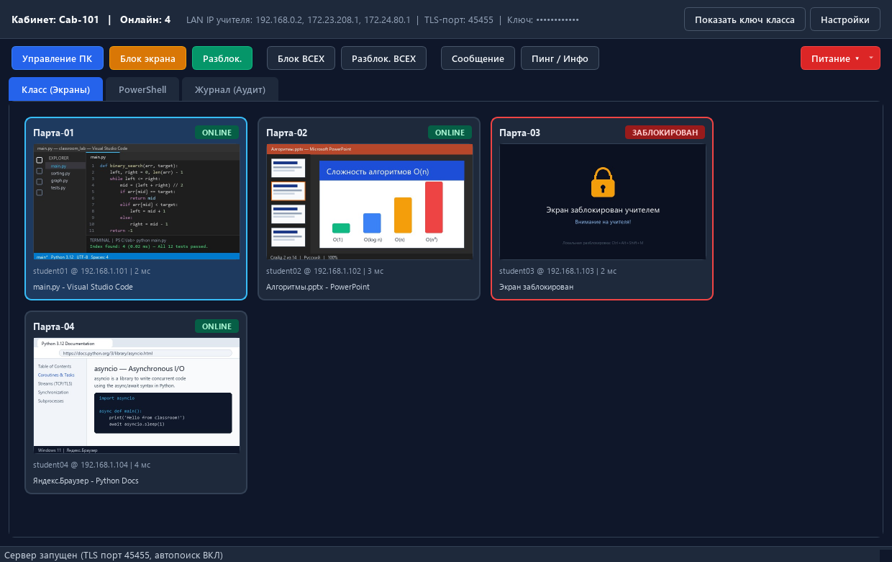
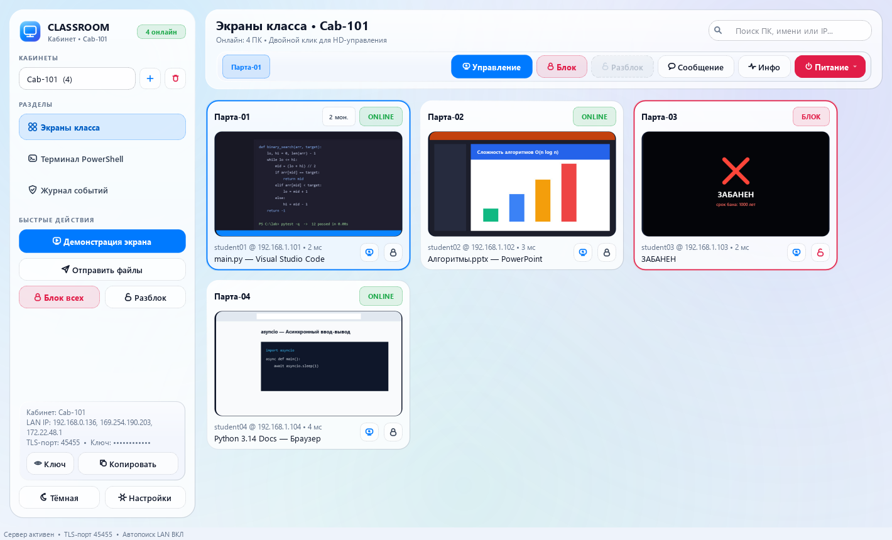
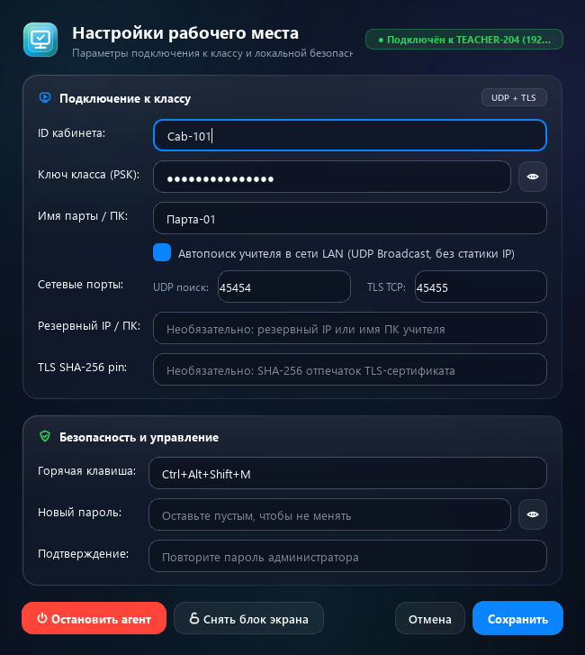

<div align="center">
  

  <h1>Classroom Manager 3.0</h1>

  <p><strong>Современная система управления компьютерным классом для Windows LAN в дизайне Liquid Glass — с единым установщиком, удалённым управлением до 60 FPS, поддержкой нескольких учителей и кабинетов, постоянным списком ПК (ONLINE/OFFLINE) и встроенным MCP-сервером для нейросетей.</strong></p>

  <p>
    <a href="https://github.com/kir1lka/classroom-manager/releases/latest"></a>
    
    
    
    
    <a href="LICENSE"></a>
  </p>
</div>

**Classroom Manager 3.0 (Liquid Glass Edition)** — это быстрый, защищённый и полностью автономный комплекс для школьных кабинетов информатики, университетских лабораторий и учебных центров. Включает **Единый установщик**, **Консоль учителя** и **Агент ученика**. Живой мониторинг с переключением мониторов прямо на карточке, плавное управление до **60 FPS**, демонстрация экрана учителя, Drag & Drop раздача файлов, мультимониторная блокировка ПК и массовый запуск PowerShell работают сразу из коробки в обычной DHCP-сети.

---

## Быстрое скачивание готовых `.exe` (без установки Python)

Готовые сборки не требуют установки Python, СУБД или сторонних библиотек — скачайте нужный файл со страницы **[Последнего релиза (Releases)](https://github.com/kir1lka/classroom-manager/releases/latest)**:

| Приложение / Скрипт | Назначение | Куда устанавливать |
| :--- | :--- | :--- |
|  **[`ClassroomManagerSetup.exe`](https://github.com/kir1lka/classroom-manager/releases/latest)** | **Единый установщик «всё в одном» (рекомендуется):** ставит Учителя / Ученика / Оба, сам настраивает Брандмауэр Windows, добавляет в автозагрузку, создаёт ярлыки + встроенная инструкция и база решений | **Любой ПК** (учителя и/или учеников) |
|  **[`ClassroomTeacher.exe`](https://github.com/kir1lka/classroom-manager/releases/latest)** | Портативная десктопная консоль управления классом (интерфейс **Liquid Glass**) | Компьютер **преподавателя** |
|  **[`ClassroomStudent.exe`](https://github.com/kir1lka/classroom-manager/releases/latest)** | Портативный фоновый агент в системном трее с автопоиском учителей в LAN | Компьютеры **учеников / студентов** |
| **`setup_firewall.ps1`** | Скрипт ручного открытия LAN-портов в Брандмауэре Windows (в установщике запускается сам) | ПК преподавателя (при портативном запуске) |

> [!TIP]
> Автоматическая сборка свежих релизов настроена через GitHub Actions (`.github/workflows/build-release.yml`), а для локальной упаковки всех трёх `.exe` предусмотрен скрипт `scripts/build_exe.ps1`.

---

## Что нового в версии 3.0

1. **Единый установщик `ClassroomManagerSetup.exe` (Liquid Glass, тёмная тема)**
   Запустите один файл — выберите роль (**Учитель**, **Ученик** или **Оба сразу**), и установщик сам скопирует файлы, настроит правила Брандмауэра Windows (с запросом прав администратора), пропишет автозагрузку, создаст ярлыки и при желании сразу заполнит конфиг ученика (`ID кабинета`, `Ключ класса`, имя ПК). Внутри установщика встроены разделы **«Инструкция»**, **«Решение проблем»** и **«Полезные команды»** с копированием в 1 клик.
2. **Плавное удалённое управление до `60 FPS`**
   Полностью переработан пайплайн захвата и передачи кадров: постоянный контекст `mss.MSS()`, прямой декодинг `BGRX`, `TCP_NODELAY`, снятие искусственного лимита 20–25 FPS. В окне управления доступны пресеты **«Плавный 60 FPS (1080p)»**, **«Игровой 60 FPS (720p)»**, **«HD Чёткий (30 FPS)»** и **«Ультра 1:1»**, а окно сразу открывается во весь экран с кнопками «На весь экран / Свернуть».
3. **Быстрая смена мониторов прямо на карточке ученика**
   Если у ученика подключено 2 и более мониторов, прямо на его карточке рядом с бейджем `ONLINE` появляется кнопка **`Экран 1`** / **`Экран 2`**. Нажмите на неё — и миниатюра на карточке мгновенно переключится на другой монитор.
4. **Одновременная работа нескольких учителей и нескольких кабинетов**
   Агент ученика теперь поддерживает параллельные TLS-сессии сразу с несколькими учителями в одной сети. Два преподавателя могут одновременно подключиться к одним и тем же кабинетам и видеть всех учеников без обрывов и конфликтов.
5. **Постоянный список учеников (`ONLINE` / `OFFLINE`) и удаление ПК**
   Выключенные компьютеры учеников больше не пропадают из сетки — они остаются в списке с серым статусом **`OFFLINE`** и автоматически возвращаются в **`ONLINE`** при следующем включении. Ненужную карточку можно убрать через **ПКМ → «Удалить ПК из списка»** (если программа на ПК ученика снова запустится, он корректно появится вновь).
6. **Удобная организация сетки класса (`Drag & Drop`, сортировка и размер карточек)**
   Естественная сортировка (`PC1 → PC2 → … → PC10`), перетаскивание карточек мышью (**Drag & Drop**) с сохранением порядка для каждого кабинета, сортировка по IP или по заблокированным ПК, а также ползунок размера карточек (`S / M / L / XL`).
7. **Мультимониторный экран бана**
   При блокировке ПК ученика с двумя и более мониторами создаётся отдельное полноэкранное окно на каждый физический экран — плашка блокировки всегда ровно по центру на каждом мониторе.

---

## Ключевые преимущества

Почему **Classroom Manager 3.0** удобнее классических решений вроде **Veyon** или **Radmin** в реальном школьном или университетском классе:

| Возможность | Classroom Manager 3.0 | Veyon | Radmin |
| :--- | :---: | :---: | :---: |
| **Работа при динамических IP (DHCP) без ручной карты адресов** | Да (`Smart Discovery`) | Требует статики / DNS / AD | Требует знания IP каждого ПК |
| **Единый установщик (авто-фаервол + автозагрузка) ИЛИ портативные `.exe`** | Да (оба варианта) | Только инсталлятор + службы | Только инсталлятор + служба |
| **Удалённое управление до 60 FPS + смена монитора на карточке** | Да (до 60 FPS) | Ограниченно | Нет миниатюр класса |
| **Несколько учителей в одном кабинете одновременно** | Да (параллельные TLS-сессии) | Сложная настройка ключей | Нет концепции кабинетов |
| **Постоянный список ПК (`ONLINE`/`OFFLINE`), Drag & Drop и размер карточек** | Да | Частично | Нет |
| **Современный UI Liquid Glass (`Dark / Light`)** | Да | Классический Qt UI | Утилитарный Win32 UI |
| **Демонстрация экрана учителя всему классу в 1 клик** | Да | Да | Нет |
| **Drag & Drop раздача файлов всему классу с проверкой `SHA-256`** | Да (+ автооткрытие) | Ограниченно | Только 1-на-1 |
| **Студия PowerShell (UTF-8) + встроенный MCP-сервер для ИИ** | Да | Только базовый запуск команд | Нет |

---

## Скриншоты интерфейса (Liquid Glass UI)

### Единый установщик `ClassroomManagerSetup.exe` (Liquid Glass Dark)


### Панель учителя — Тёмная тема Liquid Glass


### Панель учителя — Светлая тема Liquid Glass


### Студия PowerShell и библиотека сохранённых команд


### Авторизация учителя и защищённые настройки агента ученика

| Вход в консоль учителя | Защищённые настройки агента ученика (`Ctrl+Alt+Shift+M`) |
| :---: | :---: |
|  |  |

### Полноэкранная блокировка экрана ученика (на каждом мониторе)


---

## Что умеет программа (полный обзор возможностей)

###  Консоль учителя (`ClassroomTeacher.exe`)

- **Живая сетка мониторинга класса:** карточки всех подключённых и запомненных парт (`ONLINE` / `OFFLINE`) с превью экрана в реальном времени, кнопкой быстрого переключения мониторов (`Экран 1` / `Экран 2`), именем ПК, пользователем Windows, заголовком активного окна и пингом.
- **Сортировка, перетаскивание и масштаб:** естественная сортировка `PC1..PC10`, ручной порядок через **Drag & Drop** (сохраняется отдельно для каждого кабинета), ползунок размера карточек (`S / M / L / XL`) и мгновенный поиск по имени/IP.
- **Мульти-кабинеты:** добавляйте и переключайте несколько кабинетов в боковой панели (у каждого свой `ID` и ключ `PSK`) или смотрите сводный режим «Все кабинеты».
- **Удалённое управление до `60 FPS`:** двойной клик по карточке открывает полноэкранное окно детального просмотра и перехвата мыши/клавиатуры с пресетами до **60 FPS** (`1080p` / `720p`), режимом **Ультра 1:1 (HD 4:4:4)**, переключением мониторов и точным курсором в мультимониторных конфигурациях (`MOUSEEVENTF_VIRTUALDESK`).
- **Мультимониторная блокировка экрана (бан):** одной кнопкой перекрывает все мониторы выбранного ПК или сразу **всего класса** отдельными полноэкранными окнами блокировки с ровным центрированием на каждом экране.
- **Трансляция экрана учителя всему классу:** потоковая демонстрация рабочего стола преподавателя на все ученические мониторы в полноэкранном режиме (опоздавшие и переподключившиеся ПК подхватывают эфир автоматически).
- **Drag & Drop доставка файлов:** перетащите один или несколько файлов прямо на карточку ПК или в окно класса, выберите папку назначения (`Рабочий стол`, `Загрузки`, `Документы`, `Общий рабочий стол` или свой путь) и включите автооткрытие по завершении сверки `SHA-256`.
- **Студия PowerShell + MCP-сервер для нейросетей (AI):** библиотека сохранённых скриптов с выполнением на всём классе в `UTF-8`, а также встроенный локальный **MCP-сервер** (`http://127.0.0.1:45460/mcp` с Bearer-токеном) для подключения Antigravity, Claude Desktop, Cursor, VS Code или Windsurf.
- **Управление питанием, сообщения и журнал аудита:** системная блокировка Windows (`LockWorkStation`), перезагрузка, выключение, отмена выключения, всплывающие сообщения ученикам и ротируемый аудит всех действий.

###  Агент ученика (`ClassroomStudent.exe`)

- **Незаметная работа в системном трее:** не занимает место на панели задач Windows, отображая иконку со световой индикацией статуса (зелёный — на связи с учителем, жёлтый — поиск в LAN, красный — ошибка ключа).
- **Мульти-учительское подключение:** автоматически находит в LAN всех учителей своего кабинета и держит с каждым отдельную зашифрованную TLS-сессию (с дедупликацией по отпечатку сертификата на многоинтерфейсных ПК).
- **Надёжная защита паролем и секретным хоткеем:** открыть настройки, снять локальную блокировку или выйти из агента можно только после ввода пароля администратора через трей или глобальный хоткей `Ctrl+Alt+Shift+M`.
- **Автономное восстановление связи:** при перезагрузке ПК учителя, смене DHCP-адреса или пробуждении из сна агент сам находит консоль преподавателя и переподключается за секунды.

### Схема взаимодействия в локальной сети

```text
+--------------------------------------+         TLS 1.2/1.3 + HMAC-SHA256         +--------------------------------------+
|         ClassroomTeacher.exe         | <=======================================> |         ClassroomStudent.exe         |
|   (Консоль учителя • Liquid Glass)   |         (параллельные сессии к N учит.)   |    (Тихий агент в системном трее)    |
+--------------------------------------+      3-Tier Smart Discovery (UDP LAN)     +--------------------------------------+
| • Вход по паролю учителя (scrypt)    | <---------------------------------------> | • Без окна на панели задач           |
| • Сетка ONLINE/OFFLINE + Drag & Drop |                                           | • Индикатор статуса в трее Windows   |
| • Смена монитора прямо на карточке   |                                           | • Хоткей Ctrl+Alt+Shift+M + пароль   |
| • Управление до 60 FPS + HD 1:1      |                                           | • Мультимониторный экран бана        |
| • Трансляция экрана + Drag&Drop файл |                                           | • Исполнитель PowerShell (UTF-8)     |
| • Студия PowerShell + MCP-сервер ИИ  |                                           | • Ускоренный захват mss + SendInput  |
+--------------------------------------+                                           +--------------------------------------+
```

---

## Безопасность

| Уровень защиты | Реализация в Classroom Manager 3.0 |
| :--- | :--- |
| **Шифрование канала** | Обязательный **TLS 1.2 / 1.3** с автоматической генерацией сертификата `RSA-2048` и поддержкой привязки отпечатка (`SHA-256 certificate pinning`) |
| **Аутентификация в LAN** | Взаимная криптографическая проверка каждой сессии по **HMAC-SHA256 Challenge-Response** на базе общего ключа класса (`PSK`) — чужие ПК и соседние кабинеты отсекаются; сам ключ никогда не передаётся в открытом виде в UDP-маячках |
| **Хранение паролей** | Пароли преподавателя и локального администратора агента хранятся исключительно в виде криптохеша **`scrypt`** с индивидуальной случайной солью |
| **Контроль целостности и аудит** | Проверка всех передаваемых файлов по **`SHA-256`** и запись всех подключений, команд PowerShell и операций питания в ротируемый журнал аудита |

> [!IMPORTANT]
> **Рекомендация для учебных кабинетов:** устанавливайте `ClassroomStudent.exe` через `ClassroomManagerSetup.exe` от имени Администратора — установщик автоматически зарегистрирует задачу автозапуска с повышенными правами в Планировщике заданий Windows. Если ученики работают под обычной учётной записью (`Standard User`), штатные права Windows защитят агент от завершения через Диспетчер задач без ложных срабатываний антивируса.

---

## Быстрый старт за 1 минуту

### Вариант А — Через единый установщик (рекомендуется)
1. Скачайте **`ClassroomManagerSetup.exe`** со страницы **[Releases](https://github.com/kir1lka/classroom-manager/releases/latest)**.
2. **На ПК учителя:** запустите установщик, выберите **«Учитель»**, оставьте галочки «Настроить Брандмауэр Windows» и «Автозагрузка» и нажмите **«Установить»**. При первом входе задайте пароль учителя, `ID кабинета` (например, `VR1`) и скопируйте сгенерированный `Ключ класса`.
3. **На ПК учеников:** запустите тот же **`ClassroomManagerSetup.exe`**, выберите **«Ученик»**, при желании сразу введите `ID кабинета`, `Ключ класса` и имя ПК прямо в установщике и нажмите **«Установить»** — агент сразу запустится в трее и появится в сетке учителя!

### Вариант Б — Портативный запуск (без установки)
1. На ПК учителя запустите `ClassroomTeacher.exe` и один раз выполните от имени Администратора:
   ```powershell
   powershell -ExecutionPolicy Bypass -File setup_firewall.ps1
   ```
2. На ПК учеников запустите `ClassroomStudent.exe`, введите `ID кабинета`, `Ключ класса`, пароль администратора и нажмите **«Сохранить и подключиться»**.

---

## Сборка из исходников

Для локальной разработки, запуска автотестов или самостоятельной сборки `.exe` файлов потребуется **Windows 10/11** и **Python 3.11+**:

```powershell
# 1. Клонирование репозитория и создание виртуального окружения
git clone https://github.com/kir1lka/classroom-manager.git
cd classroom-manager
python -m venv .venv
.\.venv\Scripts\pip install -r requirements.txt

# 2. Запуск приложений из исходного кода
.\.venv\Scripts\python.exe -m teacher_app.main
.\.venv\Scripts\python.exe -m student_app.main
.\.venv\Scripts\python.exe -m installer_app.main

# 3. Запуск набора автотестов (протокол, TLS/HMAC, Smart Discovery, мульти-учитель, файлы, PowerShell)
.\.venv\Scripts\pytest.exe -v

# 4. Сборка ClassroomTeacher.exe, ClassroomStudent.exe и ClassroomManagerSetup.exe в папку dist\
powershell -ExecutionPolicy Bypass -File scripts\build_exe.ps1
```

### Структура репозитория

```text
classroom-manager/
├── assets/                  # Фирменные иконки приложений учителя и ученика (.png / .ico)
├── shared/                  # Сетевой фрейминг, TLS 1.3 + HMAC-SHA256 + scrypt, конфиги и логи
├── teacher_app/             # Сервер класса, UDP-ответчик, MCP-сервер, интерфейс Liquid Glass (PySide6)
├── student_app/             # Трей-агент, Smart Discovery (мульти-учитель), 60 FPS mss-стриминг, SendInput
├── installer_app/           # Единый Liquid Glass установщик (авто-фаервол, автозагрузка, инструкция, FAQ)
├── scripts/
│   ├── build_exe.ps1        # Автоматическая упаковка Teacher, Student и единого Setup.exe через PyInstaller
│   └── setup_firewall.ps1   # Настройка правил Брандмауэра Windows для локальной сети
├── docs/
│   ├── RELEASE_NOTES.md     # Подробная история релизов
│   └── screenshots/         # Скриншоты интерфейса Liquid Glass и установщика
├── tests/                   # Модульные и интеграционные автотесты
└── .github/workflows/       # CI/CD пайплайн сборки и публикации релизов на GitHub
```

---

## Авторы и контрибьюторы

- **Kirill Blinov** ([@kir1lka](https://github.com/kir1lka)) — автор проекта и архитектура
- **Google AI Neon (Antigravity)** — соавтор редизайна Liquid Glass UI, иконок, 60 FPS движка, установщика и встроенного MCP-сервера

## Лицензия

Проект распространяется под открытой лицензией **[MIT](LICENSE)** (`Copyright (c) 2026 Kirill Blinov & Google AI Neon`).
